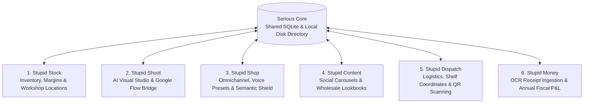

# The "Stupid Suite" by Serious Studio
> **Autonomous Multi-App Operating System for Avant-Garde Creators, Artisans & Independent Brands**

---

## 1. System Vision

The **Stupid Suite** is an autonomous, domain-focused desktop operating suite designed specifically for jewelry makers, avant-garde artisans, and rogue fashion studios.

Instead of an unwieldy, overpriced cloud monolith, the Stupid Suite is divided into **6 specialized micro-applications** anchored by a unified local foundation (`Serious Core`):



---

## 2. Core Architecture Decisions

1. **Local-First & Flow Bridge Native:**
   - Visual rendering is hooked directly into the battle-tested local Google Flow Bridge on `http://localhost:8100` (`~/Serious-AI/perso/flow-tools-dev`).
   - Zero cloud server dependencies or GPU bills for Serious Studio.
2. **Upstream Creation & Loose Coupling:**
   - `Stupid Shoot` can shoot raw concepts and moodboards before a SKU or pricing is even assigned.
   - Bidirectional flow:
     - `Ideation Flow:` Draft Concept in Shoot $\rightarrow$ Visual Validation $\rightarrow$ Mint SKU into Stock.
     - `Production Flow:` Workshop batch logged in Stock $\rightarrow$ 1-Click trigger to Shoot.
3. **Prototype-First Engineering (Anti-Bloat):**
   - No heavy framework code is written before UI/UX prototypes are reviewed.
   - Design exploration compares **Modernized Win98/Brutalist** tactile feel against **Antigravity / Google Workspace Minimalist** clean ergonomics.

---

## 3. Directory Layout

```
stupid-suite/
├── AGENTS.md                            # Master agent directive & cognitive guardrails
├── README.md                            # Suite overview & system topology
├── ROADMAP.md                           # Multi-phase master roadmap
├── STUPID_SUITE_OFFICIAL_ARCHITECTURE.md# Foundational architecture specification
├── apps/                                # The 6 Domain Micro-Applications
│   ├── stupid-stock/                    # Inventory, raw materials & unit margin engine
│   ├── stupid-shoot/                    # AI photo studio, Google Flow bridge & Flowboard
│   ├── stupid-shop/                     # Shopify/Etsy sync & Semantic Shield
│   ├── stupid-content/                  # Social format carousels & B2B PDF lookbooks
│   ├── stupid-dispatch/                 # Field logistics & QR fulfillment workflow
│   └── stupid-money/                    # Vision OCR receipt ingestion & financial P&L
├── core/                                # Shared Local Source of Truth
│   ├── README.md                        # Serious Core specification
│   └── schemas/                         # JSON schemas for loose coupling
│       ├── product_draft.schema.json    # Upstream creative concept schema
│       ├── product_sku.schema.json      # Formal cataloged inventory item schema
│       └── shoot_job.schema.json        # Google Flow rendering job payload
├── prototypes/                          # Design Prototypes & UX Experiments
│   ├── README.md                        # Prototype gallery & testing logs
│   └── design-exploration/              # UI Bake-off (Win98 Modern vs Google Minimal)
└── agents/                              # Dedicated Agent Roles
    ├── head-of-product.md               # Product & Engineering Orchestrator
    ├── core-engine.md                   # SQLite & local state agent
    ├── pixel-artisan.md                 # UI/UX design & prototype agent
    ├── shoot-vision.md                  # Google Flow AI pipeline agent
    ├── channel-gateway.md               # Commerce & logistics connector agent
    ├── money-intelligence.md            # Accounting & OCR vision agent
    └── break-tester.md                  # Robustness & chaos test agent
```
