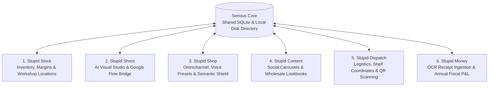

# The "Stupid Suite" by Serious Studio
> **Autonomous Multi-App Operating System for Avant-Garde Creators, Artisans & Independent Brands**  
> *Live Deployment:* [seriouscrocodile.github.io/stupid-suite](https://seriouscrocodile.github.io/stupid-suite/)

---

## 🧭 Essential Documentation for Humans & AI Agents

To quickly understand the vision, codebase, and design decisions, read these dedicated dossiers:

| Documentation File | Core Subject & Audience | Key Takeaways |
| :--- | :--- | :--- |
| 📖 [**`docs/VISION_AND_PHILOSOPHY.md`**](docs/VISION_AND_PHILOSOPHY.md) | **Vision & Atelier Manifesto** | Why the suite exists, satire of enterprise SaaS, local-first data sovereignty, loose-coupling and independent atelier personas. |
| ⚡ [**`docs/TECH_STACK_AND_ARCHITECTURE.md`**](docs/TECH_STACK_AND_ARCHITECTURE.md) | **Engineering & System Topology** | SQLite WAL database, Python engines, Vanilla JS / Tailwind CDN, Google Flow bridge (`localhost:8100`), schema contracts and rules for AI agents. |
| 🎨 [**`docs/DESIGN_SYSTEM_AND_INSPIRATIONS.md`**](docs/DESIGN_SYSTEM_AND_INSPIRATIONS.md) | **Design System & Aesthetics** | Dark luxury jewelry references (*Parts of Four*, *Rick Owens*, *Ask & Embla*), UI Bake-off (Vintage Win98 vs Google Minimalist), color palette & typography. |
| 🤖 [**`AGENTS.md`**](AGENTS.md) | **Autonomous Multi-Agent Fleet** | Cognitive heuristics (Caveman, Ponytail, Grill-Me), agent roles (`@core-engine`, `@shoot-vision`, `@pixel-artisan`), and anti-sycophancy rules. |
| 📐 [**`DESIGN_DECISIONS_AND_FEATURE_LEDGER.md`**](DESIGN_DECISIONS_AND_FEATURE_LEDGER.md) | **Architecture Decision Records (ADRs)** | Upstream creation decoupling, multi-brand boutique consignment, event suitcase lockouts, and BOM production costing. |

---

## 1. System Topology

Rather than an unwieldy, overpriced cloud monolith, the **Stupid Suite** is divided into **6 specialized micro-applications** anchored by a unified local foundation (`Serious Core`):



---

## 2. The 6 Dedicated Micro-Applications

| Application | Path | Status | Key Capabilities |
| :--- | :--- | :--- | :--- |
| **`Stupid Stock`** | [`apps/stupid-stock/`](apps/stupid-stock/) | **v1.7 Live** | Multi-brand inventory, BOM margins, consignment boutiques, event suitcases, shelf coordinates. |
| **`Stupid Shoot`** | [`apps/stupid-shoot/`](apps/stupid-shoot/) | **Prototype** | 3x3 contact sheets, local Google Flow bridge integration, alternative model casting, 2048px auto-slicing. |
| **`Stupid Shop`** | [`apps/stupid-shop/`](apps/stupid-shop/) | **Prototype** | Shopify & Etsy sync, brand voice presets, Anti-Censorship Semantic Shield for alternative jewelry. |
| **`Stupid Content`** | [`apps/stupid-content/`](apps/stupid-content/) | Planned | Automated Instagram carousels, wholesale B2B PDF lookbooks, seasonal drop calendars. |
| **`Stupid Dispatch`** | [`apps/stupid-dispatch/`](apps/stupid-dispatch/) | Planned | Physical atelier coordinates, 50x30mm thermal QR barcode printing, preparer packing app. |
| **`Stupid Money`** | [`apps/stupid-money/`](apps/stupid-money/) | Planned | Gemini Vision invoice/receipt OCR ingestion, VAT metal categorization, monthly & annual P&L. |

---

## 3. Quickstart & Local Setup

### For Human Developers:
```bash
# 1. Clone repository
git clone https://github.com/SeriousCrocodile/stupid-suite.git
cd stupid-suite

# 2. Seed database with sample atelier shops (Ask & Embla, Kaya Movement, Parts of Four)
python3 core/seed_db.py

# 3. Launch local atelier server
cd apps/stupid-stock && python3 server.py
# Open http://localhost:8000 in your browser
```

### For Claude Code / AI Agents:
Run `claude` directly inside the cloned repository. Claude Code has immediate access to all schemas in [`core/schemas/`](core/schemas/) and can inspect or extend applications directly without installing heavy dependencies.

---

## 4. Worldwide Web Preview (GitHub Pages)

The suite is statically compiled and accessible worldwide for atelier team members and remote collaborators:  
👉 **[https://seriouscrocodile.github.io/stupid-suite/](https://seriouscrocodile.github.io/stupid-suite/)**
