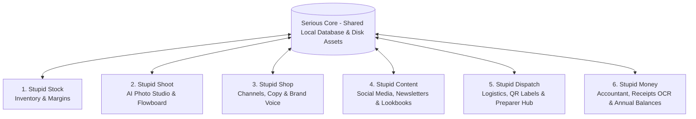

# The "Stupid Suite" by Serious Studio — Official Product Blueprint
*Autonomous Multi-App Operating System for Avant-Garde Creators, Artisans & Independent Brands*

---

## 1. Suite Philosophy & Shared Local Foundation

Rather than cramming hundreds of features into a single bloated monolith, the **Stupid Suite** is organized like Adobe Creative Cloud or Google Workspace: **6 specialized, domain-focused applications** sharing a single, local-first source of truth (Disk Folders + Unified SQLite / JSON cache).

---

## 2. The 6 Dedicated Applications

### 1. `Stupid Stock` — *Physical Inventory & Production Margins*
* **Core Mission:** Know what exists physically, what it costs to produce, and what profit margin is made.
* **Key Features:**
  * Fast spreadsheet interface with vendor/brand filtering (*Kaya Movement*, *Sismique*, or multi-client agency mode).
  * 3-tier inventory levels:
    * **B2C Stock:** Finished goods reserved for direct-to-consumer online channels.
    * **B2B Stock:** Finished goods allocated to wholesale, retailers, or consignment boutiques.
    * **Raw Materials Stock:** Raw leather hides, metal bars (brass, 925 silver), cast blanks, rivets, and hardware.
  * Real-world location tracking: France storage (e.g. Lille shelves), Bali workshop, Thailand atelier.
  * Unit production cost & gross margin calculator with automated platform fee adjustments.
  * 1-Click Bridge: "Send selected SKUs without photos to Stupid Shoot".

### 2. `Stupid Shoot` — *AI Visual Studio & Art Direction*
* **Core Mission:** High-end commercial imagery without physical studio fees or model booking costs.
* **Key Features:**
  * 3x3 contact sheet generation powered by Google Flow / Nano Banana / local bridge.
  * Virtual Talent Agency with alternative phenotypes (Berlin techno, grunge, dark avant-garde, tattoos, piercings).
  * Automated background harmonizer (`#242424` volcanic basalt, `#EFEFEF` cold concrete) and `slicer.py` HD cropper (2048x2048px).
  * Auto-save direct to product directories on the local drive with zero manual copy-pasting.
  * *Upcoming Module:* **`Flowboard`** (visual node/bubble-based single image packshot & model generator with interactive links).

### 3. `Stupid Shop` — *Sales Channels, Brand Identity & Product Copy*
* **Core Mission:** The commercial storefront manager and voice of the brand.
* **Key Channels:**
  * **Stupid Shopify:** Product descriptions, variants, collections, metafields, direct publishing.
  * **Stupid Etsy:** 13-tag optimizer, SEO title limits (140 chars), marketplace category taxonomies.
  * **Stupid Stand:** Physical event, market, and festival POS terminal with rounded cash/card pricing.
* **Brand Identity & Copywriting:**
  * Brand voice presets (dark romantic, industrial brutalist, tribal nomadic).
  * Product listing generator with built-in Anti-Censorship Semantic Shield (Safe-for-Stripe / Safe-for-Etsy).
* **Light Sales Dashboard:** Instant high-level revenue per channel (e.g. *Etsy made \$X this month, Shopify made \$Y, Festival made \$Z, Net = \$W*).

### 4. `Stupid Content` — *External Media, Socials & Lookbooks*
* **Core Mission:** Turn product assets into public-facing brand gravity and audience engagement.
* **Key Features:**
  * Reuses photos rendered by `Stupid Shoot` and specifications from `Stupid Stock`.
  * Multi-format export: Instagram carousel posts (`4:5`), Stories/Reels (`9:16`), TikTok cover layouts.
  * Newsletter drafter (campaign text + visual grid).
  * B2B Lookbook & Line Sheet PDF compiler for wholesale buyers.

### 5. `Stupid Dispatch` — *Field Logistics & QR Code Fulfillment*
* **Core Mission:** Frictionless order fulfillment for decentralized friends, family, or employees without granting them store admin access.
* **Key Features:**
  * Printable QR Code label generator for physical bags and shelf bins.
  * Clean morning packing list for the fulfillment person (e.g. Lille, France): photo of the piece, size, shelf coordinates.
  * Smartphone camera QR scanner to verify picked items.
  * 1-Tap *"Shipped"* button that automatically updates tracking numbers on Shopify and Etsy.

### 6. `Stupid Money` — *The True Accountant & Financial Intelligence*
* **Core Mission:** In-depth financial clarity, receipt tracking, and annual tax/fiscal balance sheets.
* **Key Features:**
  * **Receipt & Invoice Ingestion:** Snap a photo of an expense receipt (e.g. leather hides, casting bill, tools) via WhatsApp/Telegram/Mobile Web $\rightarrow$ Vision OCR extracts supplier, amount, VAT, date.
  * Auto-categorization into fiscal assets (e.g., Raw Materials, Production Equipment, Marketing).
  * Full fiscal year and monthly P&L balance sheets ready for tax accountants.
  * **AI Accountant Copilot:** Voice and text assistant answering complex questions (*"What was my raw metal spend vs leather spend this quarter?"*, *"Am I losing money on Etsy after Offsite Ads?"*).

---

## 3. Commercial Packaging & Phased Release

* **Tier 1 — The Pirate Power-Tool (Desktop BYOK):**
  * One-time lifetime license (\$149 – \$199) or annual pass (\$249/yr).
  * Runs locally on the creator's machine, connecting to their own Google Flow / Gemini Flash keys. Zero server GPU burn for us.
* **Tier 2 — The Cloud Multi-Tenant SaaS (Later):**
  * Hosted multi-user version with managed credits and automated continuous background sync for non-technical creators (\$49 – \$99/month).
