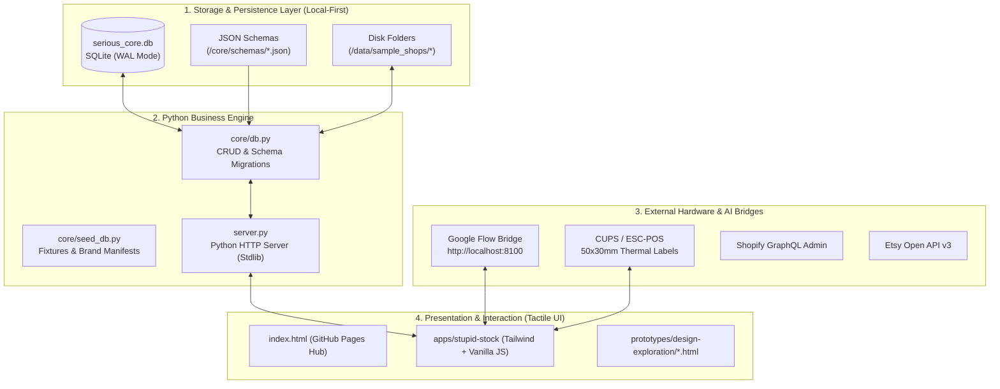

# The "Stupid Suite" — Tech Stack & Technical Architecture

> **A Guide for AI Coding Agents (Claude Code, Gemini) & Human Engineers**  
> *Target: High reliability, zero-runtime bloat, local-first data integrity.*

---

## 1. System Topology Overview



---

## 2. Technology Choices & Justifications

| Technology | Role | Why We Use It | What We Deliberately Refused |
| :--- | :--- | :--- | :--- |
| **SQLite (`serious_core.db`)** | Master database | Zero installation overhead, single-file backup, 100% offline, ACID reliability, ultra-fast queries. | PostgreSQL / MongoDB cloud instances requiring monthly costs and network lag. |
| **Python 3.10+ (Standard Library)** | Backend engine | Ubiquitous on macOS and Linux, native `sqlite3`, `pathlib`, `json`, zero pip dependency hell. | Heavy ORMs (Prisma, Django) with massive migration overhead for simple atelier tables. |
| **Vanilla JavaScript + Tailwind CSS** | Application Frontend | Instant load times, zero build step required (`npm run dev` not required for basic prototypes), works directly in browser. | Heavy Webpack/Vite bundlers that break on peer dependency mismatches. |
| **Local Google Flow Bridge (`:8100`)** | AI Generation | Connects directly to existing local Flow runtime (`~/Serious-AI/perso/flow-tools-dev`). Zero GPU costs, full creative privacy. | Cloud API credit cards (Replicate, Midjourney Discord bots, OpenAI DALL-E 3). |
| **JSON Schemas (`core/schemas/`)** | Data Validation | Strict contracts shared between Python, JS, and autonomous AI agents (`product_sku.schema.json`, `shoot_job.schema.json`). | Implicit, undocumented database shapes that cause agents to hallucinate fields. |
| **GitHub Pages** | World CDN Hosting | 100% free, version-controlled live preview for remote collaborators and atelier partners in seconds. | Vercel / Netlify / AWS S3 bills for static interface prototypes. |

---

## 3. Database Schema Blueprint (`core/schema.sql`)

The database schema is designed around 7 core tables:

```sql
-- 1. Brands partition (Multi-brand atelier support)
CREATE TABLE brands (
    id TEXT PRIMARY KEY,
    name TEXT NOT NULL,
    aesthetic TEXT,
    created_at TIMESTAMP DEFAULT CURRENT_TIMESTAMP
);

-- 2. Master Product SKU (Grouped parent / child variants)
CREATE TABLE products (
    sku TEXT PRIMARY KEY,
    brand_id TEXT NOT NULL,
    parent_sku TEXT, -- For variant hierarchy
    title TEXT NOT NULL,
    category TEXT NOT NULL, -- ring, necklace, bracelet, earring, accessory
    shelf_coordinate TEXT, -- e.g. "LILLE-CASIER-A04"
    stock_b2c INTEGER DEFAULT 0,
    stock_b2b INTEGER DEFAULT 0,
    production_cost REAL NOT NULL,
    retail_price REAL NOT NULL,
    FOREIGN KEY (brand_id) REFERENCES brands(id)
);

-- 3. Raw Materials & Atelier Inventory (BOM)
CREATE TABLE raw_materials (
    id TEXT PRIMARY KEY,
    brand_id TEXT NOT NULL,
    name TEXT NOT NULL, -- e.g. "925 Sterling Silver Grain", "Black Saddle Leather"
    quantity_on_hand REAL NOT NULL,
    unit TEXT NOT NULL, -- g, kg, m2, units
    cost_per_unit REAL NOT NULL,
    min_threshold REAL NOT NULL,
    shelf_coordinate TEXT
);

-- 4. Partner Boutiques (B2B Consignment / Dépôt-Vente)
CREATE TABLE consignment_partners (
    id TEXT PRIMARY KEY,
    name TEXT NOT NULL,
    city TEXT NOT NULL,
    commission_rate REAL DEFAULT 0.30 -- 30% boutique cut
);

-- 5. Consignment Allocation (Items placed in boutiques)
CREATE TABLE consignment_stock (
    partner_id TEXT NOT NULL,
    sku TEXT NOT NULL,
    quantity INTEGER DEFAULT 0,
    updated_at TIMESTAMP DEFAULT CURRENT_TIMESTAMP,
    PRIMARY KEY (partner_id, sku)
);

-- 6. Event & Festival Suitcases (Inventory Lockout)
CREATE TABLE event_containers (
    id TEXT PRIMARY KEY,
    name TEXT NOT NULL, -- "Hellfest 2026", "Boom Festival"
    start_date DATE NOT NULL,
    end_date DATE NOT NULL,
    status TEXT DEFAULT 'PLANNED' -- PLANNED, ACTIVE, RECONCILED
);

-- 7. Creative Shoot Jobs (Upstream Ideation)
CREATE TABLE shoot_jobs (
    id TEXT PRIMARY KEY,
    concept_title TEXT NOT NULL,
    status TEXT DEFAULT 'DRAFT', -- DRAFT, RUNNING, COMPLETED, APPROVED
    model_phenotype TEXT,
    background_hex TEXT DEFAULT '#242424',
    prompt_seed TEXT,
    output_folder TEXT
);
```

---

## 4. Architectural Rules for AI Agents (The Golden Rules)

When writing code in this repository, **Claude Code, Gemini, and human contributors must follow these directives**:

1. **Rule of the Atom (< 2-minute build steps):** Never introduce a tool or dependency that requires a complex compile toolchain if standard vanilla JS or Python standard library can do it.
2. **Preserve Database Backward Compatibility:** Any modification to `core/schema.sql` must also be reflected in `core/schemas/*.json` and must not break existing sample shop data in `data/sample_shops/`.
3. **Respect Upstream Creation:** Never make `sku` or `price` mandatory in the `Stupid Shoot` pipeline. Concepts are born wild before they are tamed into inventory.
4. **Symmetric Conflict Warnings:** When allocating stock to events, calculate total real demand across all simultaneous dates and display warnings symmetrically across all affected containers.
