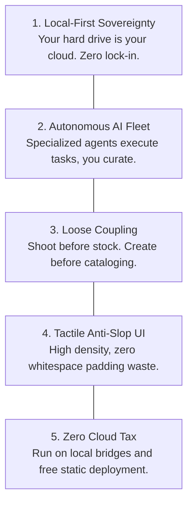

# The "Stupid Suite" — Vision & Manifesto

> **Autonomous Multi-App Operating System for Avant-Garde Creators, Artisans & Independent Brands**  
> *Created by Serious Studio (Artistic Direction & AI Engineering)*

---

## 1. Why "Stupid Suite"?

Mainstream enterprise software (Shopify Plus, SAP, NetSuite, Katana MRP, TradeGecko) was built for cookie-cutter corporations with massive spreadsheets, middle managers, and recurring monthly SaaS invoices reaching thousands of dollars.

**Independent ateliers, avant-garde jewelry designers, and rogue fashion creators operate differently:**
- They forge physical objects in small workshops (Paris, Bali, Bangkok, Berlin).
- They produce visuals before products even have a SKU or price tag.
- They sell simultaneously at physical subculture festivals (Hellfest, Boom, Wave-Gotik-Treffen), in partner consignment boutiques (Le Marais, Harajuku), and through direct-to-consumer online channels (Shopify, Etsy).
- They do not want another clunky, slow cloud dashboard that locks their data behind expensive subscription walls and requires constant internet connectivity.

The **Stupid Suite** is named as a deliberate satire of over-engineered "smart" enterprise software. It embraces radical simplicity, immediate tactile response, local data sovereignty, and zero-bullshit workflows.

---

## 2. Core Philosophy: The 5 Tenets



### 1. Local-First Sovereignty
Every piece of data lives on local disk:
- A shared lightweight SQLite database (`serious_core.db`).
- Standard file-system folders for 4K packshots, prompt templates, and thermal label PDFs.
- If internet drops during a pop-up market in the middle of nowhere, the atelier still runs 100%.

### 2. Autonomous Multi-Agent Fleet
Instead of human data-entry drudgery, specialized AI agents handle heavy lifting:
- **`@shoot-vision`**: Orchestrates local AI generation, slices 3x3 contact sheets, auto-saves to catalog folders.
- **`@channel-gateway`**: Syncs Shopify/Etsy and runs the **Anti-Censorship Semantic Shield** (protecting raw gothic/occult descriptions from automated marketplace shadowbans).
- **`@money-intelligence`**: Parses supplier invoices via Vision OCR, categorizes raw metal VAT, calculates real margin.

### 3. Upstream Creation Decoupling
Traditional ERPs force you to create a SKU, barcode, and cost before you can upload a photo. In real ateliers, you sculpt a ring, shoot it, test social reactions, and only *then* decide if you mass-produce it.  
`Stupid Shoot` and `Stupid Stock` flow in both directions:
- **Ideation Flow:** Shoot Draft $\rightarrow$ Visual Approval $\rightarrow$ Mint SKU into Stock.
- **Production Flow:** Atelier batch logged in Stock $\rightarrow$ 1-Click trigger to Shoot.

### 4. Tactile Anti-Slop UI
Modern web design is ruined by giant blank spaces, slow rounded animations, and buried hamburger menus. The Stupid Suite takes pride in:
- High-density data tables with keyboard shortcuts.
- Physical drawer/bin coordinates (`Lille Hub — Casier A-04`, `Bali Atelier — Drawer 02`).
- Brutalist contrast, crisp typography (MS Sans Serif / JetBrains Mono), tactile bevels, and micro-audio feedback.

### 5. Zero Cloud Tax
- AI imagery connects directly to the local Google Flow bridge (`localhost:8100`). **\$0 GPU hosting fees**.
- Live review hubs deploy instantly on **GitHub Pages**. **\$0 hosting fees**.

---

## 3. The 6 Dedicated Micro-Applications

```
stupid-suite/apps/
├── stupid-stock/      # Inventory, BOM margins, consignment boutiques & festival boxes
├── stupid-shoot/      # AI Contact Sheet Studio, prompt presets & HD image slicer
├── stupid-shop/       # Omnichannel (Shopify, Etsy, Stand), Brand Voice & Semantic Shield
├── stupid-content/    # Social carousels, wholesale B2B PDF lookbooks & drop calendars
├── stupid-dispatch/   # Workshop coordinates, 50x30mm thermal QR printing & packer hub
└── stupid-money/      # Vision invoice OCR, VAT metal breakdown & annual P&L
```

---

## 4. Target Persona & User Matrix

1. **The Creative Director & Master Jeweler (e.g., Serious Studio):**
   - Designs pieces, oversees aesthetics, approves visual campaigns, sets margins.
2. **The Atelier Fabricator / Consignment Manager:**
   - Manages raw silver/brass grain, logs casting weight, packs consignment batches for boutiques.
3. **The Event Nomad:**
   - Packs festival suitcases, locks inventory out of Shopify for 4 days, reconciles returns in 30 seconds.
4. **AI Coding Agents (Claude Code, Gemini, Cursor):**
   - Autonomous developers co-authoring the suite, maintaining schemas, and implementing new features.
